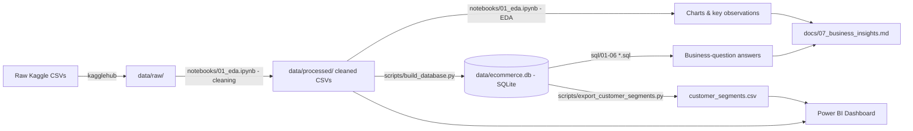

# E-Commerce Customer & Sales Intelligence

An end-to-end data analytics project analyzing ~100,000 real e-commerce orders (Olist,
Brazil's largest online marketplace integrator) to answer practical business questions around
sales performance, customer behavior, product/category performance, regional trends, delivery
operations, and customer satisfaction — plus a basic RFM customer segmentation.

Built with SQL, Python (Pandas/Matplotlib/Seaborn), and Power BI.

## Business Problem

Olist connects small Brazilian merchants to major marketplaces and manages the order,
delivery, and review lifecycle on their behalf. This project answers questions Olist's
leadership team would realistically ask:

- How is revenue trending, and what drives it?
- Who are our customers, and how many actually come back?
- Which product categories and regions matter most?
- How good is our delivery performance, and does it affect customer satisfaction?
- Which customers are worth the most, and which valuable customers are we at risk of losing?

## Dataset

[Brazilian E-Commerce Public Dataset by Olist](https://www.kaggle.com/datasets/olistbr/brazilian-ecommerce)
— 9 relational CSV files, ~100,000 orders placed between Sep 2016 and Oct 2018. Covers orders,
order items, payments, reviews, products, customers, sellers, and geolocation.

Full data dictionary and data-quality notes: [docs/01_dataset_understanding.md](docs/01_dataset_understanding.md).

## Tools

| Tool | Used for |
|---|---|
| Python (Pandas, Matplotlib, Seaborn) | Data cleaning, EDA, visualization |
| SQL (SQLite) | Structured business-question analysis, RFM segmentation |
| Power BI | Executive/customer/operations dashboard |
| Jupyter Notebook | Reproducible cleaning + analysis workflow |
| Git/GitHub | Version control, project organization |

## Architecture / Workflow



## Key Business Questions Answered

**Sales:** Total revenue, order counts, Average Order Value, monthly revenue trend, top
categories by revenue/volume.
**Customers:** Unique customers, repeat-purchase rate, highest-value customers, purchase
frequency distribution.
**Products:** Best/worst performing categories, high-volume-but-low-revenue categories,
poorly-rated categories.
**Geography:** Revenue and AOV by state, revenue concentration.
**Delivery:** Average delivery time, on-time vs late delivery rate, slowest regions, delivery
performance's link to customer satisfaction.
**Segmentation:** Recency/Frequency/Monetary (RFM) based customer segments (High Value, Loyal,
Recent, At Risk, Low Engagement).

Full question-by-question answers with real results: [docs/07_business_insights.md](docs/07_business_insights.md).

## SQL Analysis

Six progressively-structured SQL files (`sql/01` → `sql/06`), covering `SELECT`/`WHERE`/`JOIN`/
`GROUP BY`/`HAVING`/`ORDER BY`, aggregate functions, subqueries, CTEs, `CASE WHEN`, and basic
window functions (`NTILE`) for RFM scoring. Every query was executed against a real SQLite
database (`data/ecommerce.db`, built from the cleaned data) — no result was hand-written.

Full query-by-query explanations (business question → concept → line-by-line → result →
insight → interview questions): [docs/03_sql_learning.md](docs/03_sql_learning.md) and
[docs/04_customer_segmentation.md](docs/04_customer_segmentation.md) (RFM deep-dive).

## Python Analysis

[`notebooks/01_eda.ipynb`](notebooks/01_eda.ipynb) — loads the 9 raw tables, inspects data
quality, documents and applies every cleaning decision, exports cleaned CSVs, then performs
descriptive statistics, univariate analysis, and 10 business-relevant visualizations (with
"why this chart / what it shows / what to notice / business decision" for each).

Learning notes: [docs/02_data_cleaning.md](docs/02_data_cleaning.md) and
[docs/05_python_eda_learning.md](docs/05_python_eda_learning.md).

## Dashboard

A 3-page Power BI dashboard design (Executive Overview, Customer Insights, Product &
Operations) — full data model, relationships, calculated columns, and DAX measures are
specified in [dashboard/README.md](dashboard/README.md); manual build steps in
[dashboard/HOW_TO_BUILD.md](dashboard/HOW_TO_BUILD.md) (Power BI Desktop is a GUI application
and must be built manually — see that file for exactly what to do).

### Screenshots

_Add after building the dashboard in Power BI Desktop — see [dashboard/HOW_TO_BUILD.md](dashboard/HOW_TO_BUILD.md) step 7._

| Executive Overview | Customer Insights | Product & Operations |
|---|---|---|
|  |  |  |

## Key Insights

1. **On-time deliveries average 4.29★ vs 2.57★ for late deliveries** — the strongest, most
   actionable relationship found in this project.
2. **São Paulo (SP) alone contributes 37.4% of total revenue** — a real geographic
   concentration.
3. **Only ~3% of customers make a repeat purchase** — retention is a clear growth lever.
4. **Order-volume leaders and revenue leaders are different categories** (e.g. `bed_bath_table`
   leads volume, `health_beauty` leads revenue).
5. **The RFM "At Risk" segment has the 2nd-highest average revenue per customer** — a
   proven-valuable, currently-inactive group, and the clearest win-back target.

Full Observation → Evidence → Interpretation → Action write-ups for all 8 insights:
[docs/07_business_insights.md](docs/07_business_insights.md).

## Folder Structure

```
DA/
├── data/
│   ├── raw/                  # original 9 Kaggle CSVs (untouched)
│   ├── processed/            # cleaned CSVs + RFM/category summary exports
│   └── ecommerce.db          # SQLite database used by sql/*.sql
├── sql/                      # 01-06: sales, customers, products, region, delivery, RFM
├── notebooks/
│   └── 01_eda.ipynb          # cleaning + EDA notebook
├── scripts/                  # data pipeline: explore, build DB, run SQL, export tables
├── dashboard/                # Power BI data model / DAX / build guide
├── docs/                     # dataset understanding, cleaning, SQL/Python/PowerBI learning
│                             # notes, business insights, interview prep, resume bullets
├── screenshots/               # Power BI dashboard screenshots (added manually)
├── README.md
└── requirements.txt
```

## How To Run This Project

```powershell
# 1. Clone and enter the project
git clone <your-repo-url>
cd DA

# 2. Install Python dependencies
pip install -r requirements.txt

# 3. Download the raw dataset (anonymous, no Kaggle credentials needed)
python -c "import kagglehub; print(kagglehub.dataset_download('olistbr/brazilian-ecommerce'))"
# then copy the 9 CSVs from the printed path into data/raw/

# 4. Run the cleaning + EDA notebook top to bottom (produces data/processed/*.csv)
jupyter nbconvert --to notebook --execute --inplace notebooks/01_eda.ipynb

# 5. Build the SQLite database from the cleaned data
python scripts/build_database.py

# 6. Export the RFM segments and Power BI summary tables
python scripts/export_customer_segments.py
python scripts/export_powerbi_tables.py

# 7. Run any SQL file and see real results
python scripts/run_sql.py sql/01_basic_sales_analysis.sql

# 8. (Optional) Build the Power BI dashboard — see dashboard/HOW_TO_BUILD.md
```

## Future Improvements

Deliberately **not** included, to keep this project interview-safe and focused (see
[docs/08_interview_prep.md](docs/08_interview_prep.md) for how to explain these scope
decisions):

- Machine learning-based segmentation (e.g. K-Means) instead of rule-based RFM.
- Sentiment analysis / NLP on free-text review comments.
- Demand forecasting.
- A dedicated Date dimension table with full Power BI time-intelligence functions.
- Automated data-refresh pipeline (currently a manual, script-driven workflow).

## Skills Demonstrated

SQL (joins, aggregates, CTEs, subqueries, window functions), Python/Pandas data cleaning and
EDA, data visualization, Power BI data modeling and DAX, RFM customer segmentation, business
insight generation, and reproducible project/documentation structure.

---

## Learning Resources In This Repo

This repository doubles as a study resource. Read in this order:

0. [docs/00_learning_roadmap.md](docs/00_learning_roadmap.md) — what to learn before reading the rest
1. [docs/01_dataset_understanding.md](docs/01_dataset_understanding.md)
2. [docs/02_data_cleaning.md](docs/02_data_cleaning.md)
3. [docs/03_sql_learning.md](docs/03_sql_learning.md)
4. [docs/04_customer_segmentation.md](docs/04_customer_segmentation.md)
5. [docs/05_python_eda_learning.md](docs/05_python_eda_learning.md)
6. [docs/06_powerbi_learning.md](docs/06_powerbi_learning.md)
7. [docs/07_business_insights.md](docs/07_business_insights.md)
8. [docs/08_interview_prep.md](docs/08_interview_prep.md)
9. [docs/09_resume_bullets.md](docs/09_resume_bullets.md)
