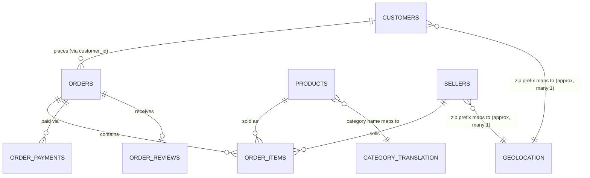

# 01 — Dataset Understanding

> Is file ka goal: dataset ko itna deeply samajhna ki tum interview mein confidently bata sako
> "yeh data kahan se aaya, kya represent karta hai, tables kaise connected hain, aur ismein
> kya problems thi." Har fact niche likha hai wo `scripts/explore_raw_data.py` chala kar
> **actually verify** kiya gaya hai — koi bhi number guess nahi kiya gaya.

## 1. Dataset source

- **Name:** Brazilian E-Commerce Public Dataset by Olist
- **Source:** Kaggle → [`olistbr/brazilian-ecommerce`](https://www.kaggle.com/datasets/olistbr/brazilian-ecommerce)
- **Downloaded via:** Python `kagglehub` library (`kagglehub.dataset_download("olistbr/brazilian-ecommerce")`)
  — anonymously, no API key needed.
- **Business context (real company):** Olist ek Brazilian **marketplace integrator** hai — matlab
  Olist khud products nahi banata/bechta. Olist chhote-medium sellers ko ek single platform deta
  hai jisse unka product multiple bade Brazilian marketplaces (like Mercado Livre, Americanas,
  etc.) pe list ho jata hai. Customer jab order karta hai, Olist us order ko manage karta hai —
  seller ko notify karna, delivery track karna, aur delivery ke baad customer se review lena.
- **Why this dataset is good for a DA portfolio project:** Yeh ek **real, anonymized, production-grade
  e-commerce dataset** hai (fake/synthetic nahi) jismein sales, customers, products, delivery
  logistics, payments, aur customer satisfaction (reviews) — sab kuch ek saath hai. Isliye is
  ek dataset se hum sales analysis, customer analysis, delivery analysis, aur satisfaction
  analysis — sab kar sakte hain, bina multiple unrelated datasets jodne ke.
- **Time period covered:** Orders `2016-09-04` se `2018-10-17` tak (~2 saal ka real transactional data).
- **Grain (sabse important cheez samajhne ke liye):** Data **order-level aur order-item-level**
  par hai — matlab ek order mein multiple products ho sakte hain, aur har product ek "line item"
  row banata hai `order_items` table mein.

## 2. Files / tables overview

Saare files `data/raw/` mein original (untouched) form mein rakhe gaye hain.

| # | File | Rows | Columns | Grain (1 row = ?) |
|---|------|------|---------|--------------------|
| 1 | `olist_customers_dataset.csv` | 99,441 | 5 | 1 customer_id (= 1 order ka customer record) |
| 2 | `olist_orders_dataset.csv` | 99,441 | 8 | 1 order |
| 3 | `olist_order_items_dataset.csv` | 112,650 | 7 | 1 product line-item within an order |
| 4 | `olist_order_payments_dataset.csv` | 103,886 | 5 | 1 payment transaction (order can have >1) |
| 5 | `olist_order_reviews_dataset.csv` | 99,224 | 7 | 1 review submission |
| 6 | `olist_products_dataset.csv` | 32,951 | 9 | 1 product |
| 7 | `olist_sellers_dataset.csv` | 3,095 | 4 | 1 seller |
| 8 | `olist_geolocation_dataset.csv` | 1,000,163 | 5 | 1 lat/lng sample for a zip code prefix |
| 9 | `product_category_name_translation.csv` | 71 | 2 | 1 category (PT-BR → English) |

**Total size on disk:** ~148 MB across all 9 CSVs.

## 3. Column meaning — table by table

### 3.1 `olist_customers_dataset.csv`

| Column | Meaning |
|---|---|
| `customer_id` | Ek **order-specific** customer key. Har naye order ke liye Olist ek naya `customer_id` generate karta hai (privacy/anonymization ke liye). |
| `customer_unique_id` | Wahi **real insaan** ko identify karta hai across multiple orders. |
| `customer_zip_code_prefix` | Customer ke postal code ke pehle 5 digits (privacy ke liye poora zip nahi diya). |
| `customer_city`, `customer_state` | Customer ka shipping city/state (state = 2-letter Brazilian state code, e.g. `SP`, `RJ`). |

> ⚠️ **Sabse important gotcha is dataset ka:** `customer_id` unique count = 99,441 (order count
> ke barabar), lekin `customer_unique_id` unique count = **96,096**. Iska matlab: agar tum
> "kitne unique customers hain" ya "repeat customers kaun hain" jaise questions ke liye
> `customer_id` use karoge, toh **har customer sirf ek hi baar order karta hua dikhega — jo
> galat hai**. Repeat-customer / RFM analysis hamesha `customer_unique_id` par based honi
> chahiye. Yeh cheez interview mein pooche jaane ka strong candidate hai.

### 3.2 `olist_orders_dataset.csv`

| Column | Meaning |
|---|---|
| `order_id` | Unique order identifier — primary key of this table, foreign key everywhere else. |
| `customer_id` | Links to `olist_customers_dataset.csv`. |
| `order_status` | Order kis stage mein hai: `delivered`, `shipped`, `canceled`, `unavailable`, `invoiced`, `processing`, `created`, `approved`. |
| `order_purchase_timestamp` | Customer ne order kab place kiya. |
| `order_approved_at` | Payment kab approve hua. |
| `order_delivered_carrier_date` | Order courier/logistics partner ko kab handover hua. |
| `order_delivered_customer_date` | Order customer tak kab pahuncha (actual delivery). |
| `order_estimated_delivery_date` | Olist ne customer ko delivery ka estimate kya diya tha. |

**`order_status` breakdown (real counts):**

| Status | Count |
|---|---|
| delivered | 96,478 (97.0%) |
| shipped | 1,107 |
| canceled | 625 |
| unavailable | 609 |
| invoiced | 314 |
| processing | 301 |
| created | 5 |
| approved | 2 |

> 📌 Business decision (detail docs/02 mein): Revenue/sales/delivery/satisfaction analysis mein
> hum mostly `delivered` orders hi consider karenge, kyunki canceled/unavailable orders mein
> actual product/payment complete nahi hua — unhe include karna revenue ko misleading bana dega.

### 3.3 `olist_order_items_dataset.csv`

| Column | Meaning |
|---|---|
| `order_id` | Kaunse order ka item hai. |
| `order_item_id` | Order ke andar item ka sequence number (1, 2, 3...) agar ek order mein multiple products hain. |
| `product_id` | Kaunsa product bika. |
| `seller_id` | Kis seller ne bheja. |
| `shipping_limit_date` | Seller ko is date tak courier ko handover karna tha. |
| `price` | Us product ki selling price (per unit line item). |
| `freight_value` | Us item ka shipping/freight charge. |

> 💡 **Revenue ka formula yahin se aata hai:** `order revenue = SUM(price) + SUM(freight_value)`
> per order (ya sirf `price` agar "product revenue" chahiye, freight alag se "shipping revenue"
> ke roop mein). Hum dono ko clearly differentiate karke document karenge jab SQL likhenge.

### 3.4 `olist_order_payments_dataset.csv`

| Column | Meaning |
|---|---|
| `order_id` | Kis order ka payment hai. |
| `payment_sequential` | Agar ek order multiple payment methods se pay hua (e.g. voucher + credit card), toh sequence number. |
| `payment_type` | `credit_card`, `boleto` (Brazil ka bank-slip payment method), `voucher`, `debit_card`, `not_defined`. |
| `payment_installments` | Kitni EMI/installments mein payment hua (Brazil mein installment payment bahut common hai). |
| `payment_value` | Us payment transaction ki amount. |

**`payment_type` breakdown:** credit_card 76,795 · boleto 19,784 · voucher 5,775 · debit_card 1,529 · not_defined 3 (negligible, will be handled as "other").

### 3.5 `olist_order_reviews_dataset.csv`

| Column | Meaning |
|---|---|
| `review_id` | Unique review identifier. |
| `order_id` | Kis order ke liye review hai. |
| `review_score` | 1 (worst) se 5 (best) tak rating — **customer satisfaction ka core metric.** |
| `review_comment_title` / `review_comment_message` | Optional free-text feedback. |
| `review_creation_date` | Review request kab bheja gaya. |
| `review_answer_timestamp` | Customer ne review kab submit kiya. |

**`review_score` breakdown:** 5★ → 57,328 · 4★ → 19,142 · 3★ → 8,179 · 1★ → 11,424 · 2★ → 3,151.
(Interesting: 1★ reviews (11,424) 2★ (3,151) se zyada hain — bimodal pattern, matlab customers
mostly ya toh bahut khush hote hain ya bahut frustrated — beech mein kam log hote hain. Yeh
observation docs/07 business insights mein use hoga.)

> ⚠️ Text fields (`review_comment_title` 88% null, `review_comment_message` 59% null) **normal**
> hain — zyada customers rating dete hain but likhte kuch nahi. Hum in text fields par NLP/sentiment
> analysis **nahi** karenge (project scope se bahar, aur unnecessarily advanced) — sirf `review_score`
> (numeric rating) use karenge.

### 3.6 `olist_products_dataset.csv`

| Column | Meaning |
|---|---|
| `product_id` | Unique product identifier. |
| `product_category_name` | Category naam, **Portuguese** mein (translation file se English milta hai). |
| `product_name_lenght` / `product_description_lenght` | Product title/description ki character length (listing quality ka signal). |
| `product_photos_qty` | Kitni photos listing mein thi. |
| `product_weight_g`, `product_length_cm`, `product_height_cm`, `product_width_cm` | Shipping ke liye physical dimensions. |

### 3.7 `olist_sellers_dataset.csv`

| Column | Meaning |
|---|---|
| `seller_id` | Unique seller identifier. |
| `seller_zip_code_prefix`, `seller_city`, `seller_state` | Seller kahan se operate karta hai. |

### 3.8 `olist_geolocation_dataset.csv`

| Column | Meaning |
|---|---|
| `geolocation_zip_code_prefix` | Zip code ka prefix (customers/sellers ke zip se match karne ke liye). |
| `geolocation_lat`, `geolocation_lng` | Latitude/longitude — map visuals ke liye. |
| `geolocation_city`, `geolocation_state` | City/state naam. |

> ⚠️ Is table ka grain **zip-code-prefix nahi, balki "sample point"** hai — ek hi zip prefix ke
> multiple lat/lng rows ho sakte hain (log real GPS pings se aaya data hai). Isme **261,831
> fully duplicate rows** bhi mile (~26% of table). Regional analysis ke liye hum sirf
> `customer_state`/`seller_state` (jo already clean hain — exactly 27 unique Brazilian states)
> use karenge; geolocation table sirf agar map visual chahiye tab use hoga (1 row per zip banane
> ke liye deduplicate karke).

### 3.9 `product_category_name_translation.csv`

Simple 2-column lookup: Portuguese category name → English category name. 71 categories mapped.

## 4. How the tables connect (relationships)

**Join keys cheat-sheet (SQL likhte waqt yeh yaad rakhna):**

| From | To | Join key |
|---|---|---|
| `orders` | `customers` | `customer_id` |
| `orders` | `order_items` | `order_id` |
| `orders` | `order_payments` | `order_id` |
| `orders` | `order_reviews` | `order_id` |
| `order_items` | `products` | `product_id` |
| `order_items` | `sellers` | `seller_id` |
| `products` | `category_translation` | `product_category_name` |

**Cardinality gotchas verified with real data (important — inn par cleaning decisions based hain):**

1. **`orders` → `order_items` is not always 1:many with data present.** 99,441 orders exist, but
   only 98,666 distinct `order_id` appear in `order_items` → **775 orders have zero line items**
   (mostly `canceled`/`unavailable` orders where nothing was ever shipped).
2. **`orders` → `order_payments` is 1:many.** 103,886 payment rows for 99,441 orders — kuch orders
   multiple payment method se pay hue (e.g. part voucher + part credit card).
3. **`orders` → `order_reviews` is *mostly* 1:1 but not always.** 99,224 review rows but only
   98,673 distinct `order_id` → 551 orders got **more than one review row** (customer ne dobara
   review submit kiya). Cleaning step mein hum latest review hi rakhenge per order.
4. **`customers` → `geolocation` and `sellers` → `geolocation` are approximate, many:1.** Ek zip
   prefix ke multiple geolocation rows hain (GPS sample points), isliye exact 1:1 join nahi hai.

## 5. Data quality issues found (verified, not guessed)

| # | Issue | Where | Real numbers | Cleaning decision (full reasoning in docs/02) |
|---|---|---|---|---|
| 1 | Missing delivery timestamps | `orders` | `order_approved_at` 160 null, `order_delivered_carrier_date` 1,783 null, `order_delivered_customer_date` 2,965 null | Expected — these orders haven't reached that lifecycle stage yet (e.g. canceled before approval). Not an error; keep as null, exclude from delivery-time averages. |
| 2 | Missing product category & attributes | `products` | 610 rows (1.85%) missing `product_category_name` + related length/photo fields together | Label as `"unknown"` category instead of dropping — product/price data is still valid and usable. |
| 3 | Category translation gap | `products` + translation file | 73 raw PT-BR categories vs 71 translations → 623 products end up without an English name | Map missing ones to `"unknown"` too, so every product still has a usable category label. |
| 4 | Duplicate geolocation rows | `geolocation` | 261,831 fully duplicated rows (~26%) | Drop exact duplicates; keep 1 representative lat/lng per zip prefix. |
| 5 | Duplicate review submissions | `order_reviews` | 551 orders have >1 review row | Keep only the latest review per `order_id` (by `review_answer_timestamp`). |
| 6 | Orders with no line items | `orders` vs `order_items` | 775 orders | Expected for canceled/unavailable orders; exclude naturally when analysis is scoped to `delivered` orders. |
| 7 | `payment_type = 'not_defined'` | `order_payments` | 3 rows only | Negligible — bucket into `"other"` during payment-type analysis rather than deleting rows. |
| 8 | Mostly-empty free-text review fields | `order_reviews` | `review_comment_title` 88.3% null, `review_comment_message` 58.7% null | Not an error — text feedback is optional. Out of scope (no NLP/sentiment analysis in this project). |
| 9 | Date columns stored as text | `orders`, `order_items`, `order_reviews` | All timestamp columns are `object` (string) dtype, not real datetime | Convert to proper `datetime64` during cleaning so date-math works correctly. |

## 6. Business questions this dataset can answer (recap)

Sales performance · Customer behavior & repeat purchases · Product/category performance ·
Regional performance · Delivery/operations performance · Customer satisfaction (ratings) ·
Basic RFM segmentation. (Full question list is being answered progressively in `sql/` and
`notebooks/01_eda.ipynb`.)

## 7. Interview angle — what to remember about this section

- **Q: "Yeh data kahan se aaya aur kis level ka hai?"** → Real, anonymized, ~100k-order Brazilian
  marketplace dataset from Kaggle (Olist), 2016–2018, 9 relational CSV files.
- **Q: "Sabse tricky part dataset samajhne mein kya tha?"** → `customer_id` vs `customer_unique_id`
  distinction — is important insight ko bolna interview mein strong signal deta hai ki tumne
  data ko sirf load nahi kiya, samjha bhi hai.
- **Q: "Tumne data quality kaise check ki?"** → Row counts, null %, duplicate rows, and referential
  coverage (kitne % foreign keys match karte hain) — sab kuch ek script (`scripts/explore_raw_data.py`)
  se verify kiya, guess nahi kiya.
