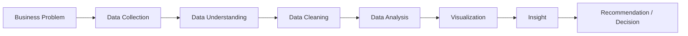

# 01 — Data Analytics From Zero

> Is file mein hum maan rahe hain tumhe Data Analytics ke baare mein **kuch bhi pata nahi** —
> bas basic programming aata hai. Har term first-principles se explain hogi.

---

## 1. What is Data Analytics?

### GENERAL CONCEPT

**Data Analytics** matlab: raw data ko dekh kar usme se **useful patterns/facts nikalna**, taaki
koi business better **decision** le sake.

Simple example (project ke bahar): Ek chai ki dukaan wala roz apni sales ek register mein likhta
hai. Agar wo mahine ke end mein baithke dekhe "kaunse din sabse zyada bikri hoti hai," "kaunsa
item sabse zyada bikta hai" — yeh **data analytics** hi hai, chahe Excel ho ya SQL ho ya sirf
kagaz-pen ho. Tools change hote hain, **core idea same rehta hai**: data dekho → pattern
nikaalo → decision lo.

### MY PROJECT

Is project mein "data" hai Olist (Brazilian e-commerce company) ka ~100,000 orders ka record.
Hum SQL aur Python use karke isme se patterns nikalte hain — jaise "kaunsi product category
sabse zyada revenue deti hai," "kitne customers dobara order karte hain" — aur phir unhe
business insights mein convert karte hain ([17_BUSINESS_INSIGHTS.md](17_BUSINESS_INSIGHTS.md)).

### INTERVIEW

**Q: "Data Analytics kya hai, apne shabdon mein batao?"**
> "Data Analytics ka matlab hai raw data ko systematically examine karke aise patterns/insights
> nikalna jo business ko koi faisla lene mein help karein — jaise revenue kyun badh/ghat raha
> hai, kaunsa customer segment valuable hai, etc."

---

## 2. Data Analyst kya karta hai (day-to-day)

Ek Data Analyst (DA) typically yeh karta hai:

1. Business team se samajhta hai **kya sawal** answer karna hai ("customer churn kyun badh raha hai?")
2. Data ko **collect/access** karta hai (database query karke, ya CSV/Excel se)
3. Data **clean** karta hai (galtiyaan/missing values/duplicates fix karta hai)
4. Data ko **analyze** karta hai (SQL queries, Pandas, Excel formulas)
5. Result ko **visualize** karta hai (charts, dashboards)
6. Ek **insight/recommendation** likhta hai jo koi non-technical manager bhi samajh sake

Is poore project mein humne bilkul yehi 6 steps kiye hain (dekho `docs/learning/18` full
walkthrough ke liye).

## 3. Data Analyst vs Data Scientist vs Data Engineer vs Business Analyst vs Product Analyst

Yeh roles interview mein bahut confuse karte hain — table se yaad rakho:

| Role | Core Kaam | Tools | Example Question |
|---|---|---|---|
| **Data Analyst (DA)** | Existing data se patterns/insights nikalna, dashboards banana | SQL, Excel, Power BI/Tableau, basic Python | "Last quarter revenue kyun gira?" |
| **Data Scientist (DS)** | Predictive models banana (ML), future predict karna | Python/R, ML libraries (scikit-learn), stats | "Agla mahina kitna revenue hoga?" |
| **Data Engineer (DE)** | Data pipelines banana — data ko collect/store/move karne ka infrastructure | SQL, Python, Spark, Airflow, Cloud (AWS/GCP) | "Data reliably database mein kaise laayein roz?" |
| **Business Analyst (BA)** | Business processes samajhna, requirements gather karna (zaroori nahi technical ho) | Excel, basic SQL, documentation | "Naye feature ki business requirement kya hai?" |
| **Product Analyst** | Ek specific product/feature ke usage-data ko analyze karna | SQL, Python, product-analytics tools (Mixpanel etc.) | "Naya feature launch hone ke baad engagement badha ya nahi?" |

**Simple rule of thumb:** DA = "samajhna ki kya hua" (past/present, descriptive). DS = "predict
karna ki kya hoga" (future, predictive). DE = "data ka pipeline/plumbing banana." Yeh roles
overlap bhi karte hain real companies mein (especially startups), lekin core focus yehi hai.

> **Is project mein hum kya kar rahe hain?** Pure **Data Analyst** kaam — descriptive analysis
> (kya hua, kyun hua) + ek simple rule-based segmentation (RFM). Koi predictive ML model nahi
> banaya — isliye yeh ek DA project hai, DS project nahi.

---

## 4. Core Vocabulary (yeh terms poore book mein baar-baar aayenge)

| Term | Simple Hinglish Meaning | Chhota Example |
|---|---|---|
| **Raw data** | Bilkul original data, jaisa collect hua tha — koi cleaning/processing nahi hui | `data/raw/` folder ki 9 CSVs |
| **Structured data** | Rows aur columns mein organized data (jaise Excel sheet/database table) | Har CSV file ek structured table hai |
| **Dataset** | Related data ka ek collection, ek analysis ke liye use hone wala | Poora Olist e-commerce data |
| **Row (record)** | Table mein ek single entry — ek "cheez" ka poora data | `orders` table mein ek row = ek order |
| **Column (field)** | Table mein ek specific type of information, har row ke liye | `order_status` ek column hai |
| **Feature / Variable** | Ek column ko jab analysis/modeling ke context mein bolte hain | `review_score` ek "variable" hai jo satisfaction measure karta hai |
| **Dimension** | Wo column jispar hum data ko "group/slice" karte hain — usually categorical/text | `product_category`, `customer_state` |
| **Measure** | Wo column jise hum **aggregate** (SUM/AVG/COUNT) karte hain — usually numeric | `price`, `revenue`, `review_score` |
| **Metric** | Ek specific calculated number jo business tracks karta hai | "Total Revenue", "Average Order Value" |
| **KPI** (Key Performance Indicator) | Ek metric jo itna important hai ki business use regularly monitor karta hai | "On-Time Delivery %" ek KPI ho sakta hai operations team ke liye |
| **Insight** | Data se nikala gaya ek meaningful, actionable fact | "Late delivery se rating 1.72 stars gir jaati hai" |
| **Dashboard** | Multiple charts/KPIs ka ek interactive, single-screen visual summary | Humara 3-page Power BI dashboard design |
| **Report** | Usually ek static, point-in-time summary (dashboard interactive hota hai, report zyada fixed) | Ek monthly PDF sales report |
| **Business question** | Ek plain-English sawal jo koi manager pooch sakta hai | "Hamare best customers kaun hain?" |
| **Analytical question** | Business question ka data/technical translation | "RFM scores ke hisab se top decile customers kaun hain?" |
| **Decision** | Insight ke basis par company jo action leti hai | "At Risk segment ko discount email bhejna" |

> **Metric vs KPI mein fark (common confusion, interview trap):** Har KPI ek metric hai, lekin
> har metric KPI nahi hota. Metric = koi bhi measured number. KPI = wo metric jo itna critical
> hai ki business regularly track karti hai apne goals ke against. (Dekho
> [28_COMMON_MISTAKES.md](28_COMMON_MISTAKES.md) mistake #1.)

---

## 5. The Data Analytics Workflow (yeh sabse important cheez hai is file mein)

Har stage ka matlab, kyun exist karta hai, aur DA yahan kya karta hai:

### Stage 1 — Business Problem
- **Kya hai:** Ek real-world sawal jo company answer karna chahti hai.
- **Kyun exist karta hai:** Bina ek clear question ke, data analysis directionless ho jaati hai
  — tum kuch bhi nikaal sakte ho jo kisi kaam ka na ho.
- **DA kya karta hai:** Stakeholders (managers/business team) se baat karke sawal ko **specific
  aur measurable** banata hai. ("Sales kaisi hai?" → "Delivered orders ka total revenue aur
  monthly trend kya hai?")

### Stage 2 — Data Collection
- **Kya hai:** Wo data dhoondhna/access karna jo is sawal ka jawab de sake.
- **Kyun exist karta hai:** Sahi data ke bina koi analysis possible hi nahi hai.
- **DA kya karta hai:** Database se query karta hai, ya CSV/API/existing files use karta hai.

### Stage 3 — Data Understanding
- **Kya hai:** Data ko "explore" karna bina use badle — kitni rows hain, kaunse columns hain,
  kya missing hai, tables kaise connected hain.
- **Kyun exist karta hai:** Bina data samjhe cleaning/analysis shuru karna galtiyon ki taraf le
  jaata hai (jaise galat column ko unique-identifier maan lena).
- **DA kya karta hai:** `.info()`, `.describe()`, null counts, duplicate counts check karta hai.

### Stage 4 — Data Cleaning
- **Kya hai:** Data ki problems (missing values, duplicates, wrong types, inconsistent
  categories) ko fix karna.
- **Kyun exist karta hai:** "Garbage in, garbage out" — galat/dirty data se nikala insight bhi
  galat hoga.
- **DA kya karta hai:** Missing values ko fill/drop karta hai, duplicates hataata hai, date
  columns ko sahi type mein convert karta hai, etc.

### Stage 5 — Data Analysis
- **Kya hai:** Actual calculations/queries chalana jo business question ka answer den.
- **Kyun exist karta hai:** Yeh core step hai jahan raw cleaned data "answers" mein convert
  hota hai.
- **DA kya karta hai:** SQL queries likhta hai, Pandas mein aggregate karta hai, statistics
  nikaalta hai.

### Stage 6 — Visualization
- **Kya hai:** Numbers ko charts/graphs mein convert karna.
- **Kyun exist karta hai:** Insaan tables/numbers se zyada tez **patterns ko visually** samajhta
  hai — ek chart ek table se zyada jaldi "clip" hota hai dimag mein.
- **DA kya karta hai:** Sahi chart type choose karta hai (bar/line/histogram/etc.) data ke type
  ke hisab se.

### Stage 7 — Insight
- **Kya hai:** Chart/number se ek meaningful, plain-English fact nikalna.
- **Kyun exist karta hai:** Sirf chart dikhana kaafi nahi — "so what?" ka jawab dena padta hai.
- **DA kya karta hai:** Observation ko business-context ke saath jodta hai
  ("Observation → Evidence → Interpretation → Action" — dekho `docs/learning/17`).

### Stage 8 — Recommendation / Decision
- **Kya hai:** Insight ke basis par "ab company ko kya karna chahiye."
- **Kyun exist karta hai:** Yeh poore workflow ka end-goal hai — analysis sirf "interesting"
  hone ke liye nahi, **action lene** ke liye hoti hai.
- **DA kya karta hai:** Ek clear, specific suggestion deta hai (jaise "At Risk segment ko
  targeted email campaign se re-engage karo").

### Yeh poora workflow — MY PROJECT mein mapping

| Workflow Stage | Is project mein exact jagah |
|---|---|
| Business Problem | README.md ka "Business Problem" section — Olist leadership ke real sawal |
| Data Collection | `kagglehub` se Olist dataset download (`data/raw/`) |
| Data Understanding | `scripts/explore_raw_data.py` + [docs/01_dataset_understanding.md](../01_dataset_understanding.md) |
| Data Cleaning | `notebooks/01_eda.ipynb` Sections 1-6 + [docs/02_data_cleaning.md](../02_data_cleaning.md) |
| Data Analysis | `sql/01`-`06_*.sql` + notebook EDA sections |
| Visualization | Notebook ke 10 charts + Power BI dashboard design |
| Insight | [docs/07_business_insights.md](../07_business_insights.md) — 8 insights |
| Recommendation | Har insight ke saath "Possible action" |

### INTERVIEW

**Q: "DA workflow ke steps batao."**
> Simple answer: "Pehle business problem samajhte hain, phir data collect/understand karte
> hain, clean karte hain, analyze karte hain, visualize karte hain, aur end mein ek insight aur
> recommendation nikaalte hain jo business use kar sake."

**Q: "Sabse zyada time konsa step leta hai, real projects mein?"**
> Industry mein commonly kaha jaata hai **data cleaning + understanding** sabse zyada time
> leta hai (kabhi-kabhi 60-80% tak) — is project mein bhi cleaning section (`docs/02`) sabse
> detailed hai kyunki 8 tables mein alag-alag issues the.

---

## What I should remember (quick summary)

- Data Analytics = raw data se business-useful patterns nikalna.
- DA vs DS vs DE vs BA vs Product Analyst — sabki core kaam alag hai (table yaad rakho).
- Workflow: Business Problem → Collection → Understanding → Cleaning → Analysis →
  Visualization → Insight → Recommendation.
- Metric ≠ KPI (har KPI metric hai, har metric KPI nahi).
- Yeh poora workflow hamare is project mein bhi exactly follow hua hai — agla file
  ([02_PROJECT_OVERVIEW.md](02_PROJECT_OVERVIEW.md)) isko detail mein dikhayega.
