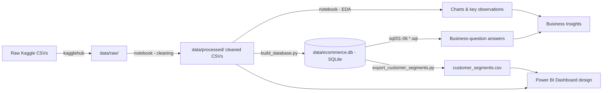

# 02 — Project Overview

> Is file ka goal: poora project **zero se** samjhna — bina kisi SQL/Python/Power BI detail mein
> jaaye, sirf **"kya, kyun, kaise"** ke level par. Detail files (03 se aage) isी overview ko
> deeply expand karenge.

---

## 1. What business problem are we trying to solve?

**Olist** ek real Brazilian company hai — ek **marketplace integrator**. Matlab Olist khud
products nahi banata/bechta; wo chhote/medium sellers ko ek platform deta hai jisse unke
products bade Brazilian marketplaces (jaise Mercado Livre) par list ho jaate hain. Jab customer
order karta hai, Olist poora lifecycle manage karta hai — seller ko notify karna, delivery
track karna, aur delivery ke baad customer se review lena.

Is project mein hum **Olist ke leadership team** ki taraf se sochte hain aur unke realistic
business sawalon ke jawab deते hain:

1. Revenue kaisa trend kar raha hai, aur kya drive kar raha hai?
2. Hamare customers kaun hain, aur kitne actually dobara aate hain?
3. Kaunsi product categories aur regions sabse zyada matter karte hain?
4. Hamari delivery kitni achhi hai, aur kya isse customer satisfaction affect hoti hai?
5. Kaunse customers sabse valuable hain, aur kaunse valuable customers hum khone wale hain?

Yeh bilkul waise hi sawal hain jo ek real e-commerce/marketplace company ki leadership apni
Data Analytics team se poochegi — isliye yeh project sirf "practice ke liye" nahi, **realistic
business framing** ke saath banaya gaya hai.

## 2. Business Context

- Company type: E-commerce marketplace integrator (Olist).
- Geography: Brazil.
- Time period covered by data: September 2016 – October 2018 (~2 saal).
- Scale: ~100,000 orders, ~96,000 unique customers, ~3,100 sellers, 71 product categories.

## 3. Dataset (summary — full deep-dive in file 03)

**Brazilian E-Commerce Public Dataset by Olist** (Kaggle) — 9 relational CSV files covering
orders, order items (line items), payments, reviews, products, customers, sellers, and
geolocation.

## 4. Goals of this project

- Real business questions ko SQL aur Python se answer karna (sirf "practice queries" nahi).
- Data ko sahi tarike se clean karna aur **har decision ko justify** karna.
- Customers ko ek simple, explainable framework (RFM) se segment karna.
- Findings ko ek Power BI dashboard design mein present karna.
- Poore process ko itna documented rakhna ki koi bhi (including khud tum, interview mein)
  har decision ka "why" samajh sake.

## 5. Main Business Questions (recap)

**Sales:** Total revenue, order counts, Average Order Value, monthly revenue trend, top
categories by revenue/volume.
**Customers:** Unique customers, repeat-purchase rate, highest-value customers, purchase
frequency distribution.
**Products:** Best/worst performing categories, high-volume-but-low-revenue categories,
poorly-rated categories.
**Geography:** Revenue and AOV by state, revenue concentration.
**Delivery:** Average delivery time, on-time vs late delivery rate, slowest regions, delivery
performance's link to customer satisfaction.
**Segmentation:** RFM-based customer segments (High Value, Loyal, Recent, At Risk, Low
Engagement).

## 6. Tools — kya use kiya aur kyun

| Tool | Used for | Kyun yeh tool (chhota reason) |
|---|---|---|
| **Python (Pandas, Matplotlib, Seaborn)** | Data cleaning, EDA, visualization | Complex multi-step cleaning logic aur charts ke liye best — flexible, code-based |
| **SQL (SQLite)** | Structured business-question analysis, RFM segmentation | Structured "business questions" (aggregates, rankings) ke liye SQL fastest/clearest hai; SQLite isliye kyunki zero-setup, file-based, is project ke scale (~100k rows, single-user) ke liye kaafi hai |
| **Power BI** | Executive/customer/operations dashboard (design) | Non-technical stakeholders ke liye interactive, visual dashboard — SQL/Python output ko "consume karne layak" banata hai |
| **Jupyter Notebook** | Reproducible cleaning + analysis workflow | Code + explanation + chart output ek hi jagah, step-by-step reproducible |
| **Git/GitHub** | Version control, project organization | Industry-standard project tracking/sharing |

> Poora "kyun yeh tool aur kyun nahi doosra" discussion:
> [18_END_TO_END_PROJECT_WALKTHROUGH.md](18_END_TO_END_PROJECT_WALKTHROUGH.md) section "Why
> this tool at this step."

## 7. Workflow — Full Pipeline



**Plain-English version:**

```
DATA (raw CSVs)
   |
CLEANING (Python/Pandas notebook)
   |
   +--> SQL (structured business-question answers, RFM)
   |
   +--> PYTHON EDA (charts, distributions, patterns)
   |
POWER BI (dashboard design combining both)
   |
BUSINESS INSIGHTS (Observation -> Evidence -> Interpretation -> Action)
   |
BUSINESS DECISIONS (what Olist could actually do)
```

## 8. Output of this project

- A cleaned, analysis-ready dataset (`data/processed/*.csv`) + a queryable SQLite database
  (`data/ecommerce.db`).
- 6 SQL analysis files answering ~25 structured business questions with real, verified numbers.
- A Jupyter notebook with documented cleaning steps + 10 business-relevant charts.
- A rule-based RFM customer segmentation (5 segments, exported to CSV).
- A **fully specified** 3-page Power BI dashboard (data model, relationships, DAX measures,
  page/visual layout) — see honesty note below.
- 8 documented business insights with real evidence and suggested actions.

> ⚠️ **Important honesty point (bolo isे interview mein bhi, chhupao mat):** Power BI Desktop
> ek GUI application hai jo is automated/scripted environment se directly nahi chal sakti.
> Is project mein Power BI ka **poora build-ready design** hai — sabhi data model relationships,
> calculated columns, aur DAX measures likhe/decide ho chuke hain
> ([dashboard/README.md](../../dashboard/README.md)) — lekin actual `.pbix` file Power BI
> Desktop mein manually banai jaani hai
> ([dashboard/HOW_TO_BUILD.md](../../dashboard/HOW_TO_BUILD.md) follow karke). Agar interviewer
> screenshots maange, sach batao: "Dashboard ka poora design/spec ready hai, main isे Power BI
> Desktop mein build kar sakta hoon — yeh raha exact plan," aur spec dikhao.

## 9. Findings (recap — full detail in file 17)

1. On-time deliveries average **4.29★** vs **2.57★** for late deliveries.
2. São Paulo (SP) alone contributes **37.4%** of total revenue.
3. Only **~3%** of customers make a repeat purchase.
4. Order-volume leaders and revenue leaders are **different categories**.
5. The RFM "At Risk" segment has the **2nd-highest average revenue per customer**.

---

## 10. "Explain My Project" — 4 lengths (practice these out loud)

### 30 seconds

> "Maine Olist — ek Brazilian e-commerce marketplace — ke ~100,000 real orders ka data liya,
> use SQL aur Python se clean aur analyze kiya, customers ko RFM technique se segment kiya, aur
> ek Power BI dashboard design banaya. Sabse bada finding yeh tha ki late delivery customer
> rating ko 4.29 se 2.57 tak gira deti hai — yeh sabse strong, actionable insight tha."

### 1 minute

> "Yeh ek end-to-end Data Analytics project hai Olist ke real ~100k-order e-commerce dataset
> par. Maine pehle 9 raw tables ko clean kiya — jaise date columns fix karna, duplicate reviews
> hataana, missing categories handle karna — har decision ko document karte hue. Phir SQL mein
> 25+ queries likhi sales, customer, product, region, aur delivery performance ke real business
> sawalon ke jawab dene ke liye — ek SQLite database par jo maine khud cleaned data se banaya.
> Customers ko maine RFM (Recency, Frequency, Monetary) se 5 segments mein baanta — jismein
> 'At Risk' segment sabse interesting nikla, kyunki wo pehle high-spenders the lekin ab inactive
> hain. Python mein 10 charts banaye EDA ke liye, aur ek 3-page Power BI dashboard design kiya.
> Sabse bada insight: on-time delivery customer rating ko 4.29 se badhaकर 2.57 se compare mein
> bahut zyada rakhti hai — delivery reliability hi is business ka sabse bada satisfaction lever
> hai."

### 2 minutes

> "Yeh project Olist — jo Brazil ki sabse badi e-commerce marketplace-integrator company hai —
> ke real ~100,000-order dataset par based hai. Maine business ki taraf se socha: 'agar main
> Olist ki Data Analytics team mein hota, leadership kaunse sawal poochti?' — jaise revenue trend
> kaisa hai, customers repeat karte hain ya nahi, delivery satisfaction ko kaise affect karti
> hai.
>
> Sabse pehle maine dataset ko deeply samjha — 9 relational tables, unke beech relationships,
> aur ek bahut important gotcha: `customer_id` order-level unique hai jabki `customer_unique_id`
> hi real insaan ko identify karta hai — is fark ko samajhna repeat-customer analysis ke liye
> zaroori tha.
>
> Phir maine Python/Pandas mein data clean kiya — 8 tables mein alag-alag issues the (missing
> categories, duplicate reviews, geolocation duplicates, text-format dates) — har cleaning
> decision ko reasoning ke saath document kiya, kuch bhi blindly delete nahi kiya.
>
> Cleaned data se maine ek SQLite database banaya aur SQL mein 6 files, 25+ queries likhi —
> JOINs, GROUP BY, HAVING, subqueries, CTEs, aur ek window function (NTILE) RFM scoring ke liye
> use karte hue. Customers ko RFM (Recency/Frequency/Monetary) se 5 business-meaningful segments
> mein baanta — 'At Risk' segment sabse valuable insight nikla kyunki unka average spend 2nd
> highest tha sabhi segments mein, despite inactive hone ke.
>
> Python mein 10 EDA charts banaye — order status, ratings, price distribution, delivery time,
> monthly trend, category performance, regional revenue, aur delivery-vs-satisfaction
> relationship (jo sabse strong insight nikla: on-time orders 4.29 stars vs late orders 2.57
> stars).
>
> End mein, maine ek 3-page Power BI dashboard poora design kiya — data model, relationships,
> DAX measures — Executive Overview, Customer Insights, aur Product & Operations pages ke saath.
>
> Poore project se 8 documented business insights nikले, jaise SP state akela 37% revenue
> contribute karta hai, aur sirf 3% customers repeat purchase karte hain — dono clear,
> actionable business opportunities hain."

### 5 minutes

> (Use the 2-minute version as the backbone, then add:)
>
> "...Ek cheez jo main highlight karna chahunga: maine is project mein jaan-boojh kar advanced
> ML/clustering, NLP sentiment analysis, ya forecasting **nahi** ki — kyunki goal tha ek project
> banana jiska har hissa main khud fully samajh sakoon aur defend kar sakoon, bina 'black box'
> techniques ke upar depend hue. Jahan bhi RFM jaisi simpler-but-explainable technique kaafi
> thi, maine wahi choose ki.
>
> Maine kuch real bugs bhi khud pakड़े aur fix kiye — jaise RFM recency scoring mein direction
> ulti thi shuru mein (stale customers ko best score mil raha tha), aur SQLite joins bina index
> ke bahut slow the (`pandas.to_sql()` by default koi index nahi banata) — dono ko verify karke
> fix kiya.
>
> Agar mujhe is project ko aage badhana ho, toh main ek proper Date dimension table add karta
> Power BI time-intelligence ke liye, aur review-text par basic sentiment analysis explore
> karta — dono README mein explicitly 'Future Improvements' ki tarah documented hain, ek honest
> scope-boundary ki tarah, na ki ek missed cheez ki tarah."

---

## What I should remember

- Business problem: Olist leadership ke realistic sales/customer/delivery sawal answer karna.
- Pipeline: Raw data → Clean (Python) → SQL analysis + RFM → Python EDA charts → Power BI
  design → Business insights → Recommendations.
- Power BI dashboard **poori tarah designed hai** (spec/DAX/relationships) lekin `.pbix` file
  khud Power BI Desktop mein manually banani hogi — is fact ko chhupao mat, honestly bolo.
- 4 pitch lengths practice karo (30s/1min/2min/5min) — interview mein "tell me about your
  project" ka answer yehi hoga.
