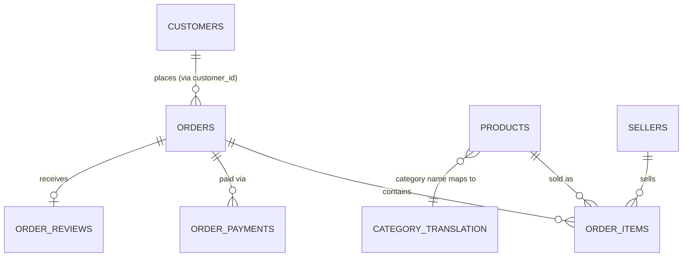

# 04 — Database and Data Model

> Is file mein hum database ke **fundamental building blocks** samjhenge — bilkul zero se —
> phir dekhenge yeh concepts humare project (`data/ecommerce.db`) mein kaise dikhte hain.

---

## 1. Database Basics (GENERAL)

| Term | Simple Meaning | Chhota Example |
|---|---|---|
| **Database** | Organized data ka ek collection, jo store/query/update ho sake | `data/ecommerce.db` (ek SQLite file) |
| **Table** | Database ke andar ek grid — rows aur columns | `orders`, `customers`, etc. |
| **Row** | Table mein ek single record | Ek order |
| **Column** | Table mein ek specific attribute | `order_status` |
| **Primary Key (PK)** | Ek column (ya combination) jo **har row ko uniquely identify** karta hai, kabhi NULL nahi ho sakta, kabhi repeat nahi hota | `orders.order_id` |
| **Foreign Key (FK)** | Ek column jo **doosri table ke Primary Key ko reference** karta hai — relationship banata hai | `order_items.order_id` (points to `orders.order_id`) |

**Analogy:** Socho ek **library**. Har book ka ek unique "Book ID" hai (Primary Key). Har
"borrow record" mein ek "Book ID" column hai jo batata hai kaunsi book issue hui thi (Foreign
Key) — us borrow-record table ko books table se jodne ke liye.

### Why does a database need Primary/Foreign Keys?

Bina PK ke, tumhe pata hi nahi chalega ki do rows "same cheez" hain ya "do alag cheezein jo
coincidentally same dikhti hain." Bina FK ke, do tables ko reliably jodna possible nahi —
tumhe guess karna padega kaunsa column kaunse se match karta hai.

## 2. Relationships — 1:1, 1:many, many:many

| Type | Matlab | Example (general) | Example (is project mein) |
|---|---|---|---|
| **One-to-One (1:1)** | Table A ki ek row, Table B ki bilkul ek row se match karti hai | Ek insaan → ek passport | `orders.customer_id` ↔ `customers.customer_id` |
| **One-to-Many (1:many)** | Table A ki ek row, Table B ki multiple rows se match kar sakti hai | Ek teacher → multiple students | `orders` → `order_items` (ek order, multiple products) |
| **Many-to-Many (M:N)** | Dono taraf multiple matches ho sakte hain (usually ek "junction table" ke through) | Students ↔ Courses (ek student multiple courses, ek course multiple students) | Is project mein directly nahi hai (par `products` ↔ `orders` conceptually M:N hai, `order_items` junction table ki tarah kaam karta hai) |

### Normalization (very basic, practical level)

**Normalization** ka matlab hai data ko **repeat hone se bachana** — ek fact ko sirf ek jagah
store karna, aur usse baaki jagah **reference** (FK) karna.

- **Bina normalization ke:** Har `order_items` row mein poora product-detail (naam, category,
  weight, etc.) repeat hota — 112,650 rows mein wahi product-info baar-baar.
- **Normalization ke saath (jo is project mein hai):** `order_items` sirf `product_id` rakhta
  hai; poori product detail sirf ek baar `products` table mein hai. Jab chahiye, JOIN se laate
  hain.

**Kyun better hai:** Kam storage, aur agar kisi product ka naam update karna ho, sirf ek jagah
(products table mein) badalna padta hai — sab jagah automatically sahi rahega.

> 🟢 Optional depth: Real normalization "forms" (1NF/2NF/3NF) hote hain — is project/interview
> ke liye itni detail zaroori nahi. Bas yeh samjho: **"same fact ko baar-baar mat store karo,
> ek jagah rakho aur reference karo"** — yehi core idea hai.

---

## 3. JOIN Concepts

### GENERAL

JOIN do (ya zyada) tables ko ek **common column (key)** ke through jodta hai, taaki dono ka
data ek saath dikh sake.

**Real-life analogy:** Socho tumhare paas do register hain — ek mein "Roll Number → Student
Naam," doosre mein "Roll Number → Marks." Agar tumhe "Student Naam aur Marks dono ek saath"
chahiye, tum dono registers ko **Roll Number se match** karke jodoge — yehi JOIN hai.

| JOIN Type | Kya deta hai | Analogy |
|---|---|---|
| **INNER JOIN** | Sirf wo rows jo **dono** tables mein match karti hain | Sirf un students ka data dikhao jinke both register mein entry hai |
| **LEFT JOIN** | Left table ki **saari** rows, chahe right mein match ho ya na ho (na ho toh NULL) | Saare students dikhao (chahe unke marks record mile ya na mile) |
| **RIGHT JOIN** | Right table ki saari rows (LEFT JOIN ka mirror) | Kam use hota hai — usually LEFT JOIN se hi kaam chal jaata hai (tables switch karke) |
| **FULL JOIN** | Dono tables ki saari rows, match ho ya na ho | Rarely used in typical business analysis; SQLite mein directly support bhi nahi karta |

### Tiny SQL example (generic, project ke bahar)

```sql
-- INNER JOIN: sirf matching rows
SELECT s.name, m.marks
FROM students s
INNER JOIN marks m ON s.roll_no = m.roll_no;

-- LEFT JOIN: saare students, chahe marks ho ya na ho
SELECT s.name, m.marks
FROM students s
LEFT JOIN marks m ON s.roll_no = m.roll_no;
```

### MY PROJECT — Joins actually used

| Join | Type | Kahan | Kyun yeh type |
|---|---|---|---|
| `order_items` ↔ `orders` | INNER | Har revenue/sales query | Sirf un line-items ki zaroorat hai jinka order record maujood hai — practically hamesha match hoga |
| `order_items` ↔ `products` | INNER | Category-level analysis | Har order-item ka product record hona hi chahiye |
| `orders` ↔ `customers` | INNER (practically 1:1) | Customer/regional analysis | `customer_id` hamesha exist karta hai orders mein |
| `products` ↔ `category_translation` | **LEFT** (Pandas `.merge(how="left")`) | Cleaning step (notebook Section 4.6) | Kuch categories ka translation missing tha — LEFT JOIN se wo products bhi result mein rahe (na ki silently gayab ho jaayein), category = `"unknown"` assign hui |

> 📌 **LEFT JOIN kyun use kiya yahan, INNER kyun nahi (interview-important):** Agar INNER JOIN
> karte `products` aur `category_translation` ke beech, jin 623 products ki category-translation
> missing thi, wo **poori tarah result se gayab ho jaate** — bina kisi error/warning ke,
> silently data loss. LEFT JOIN unhe rakhta hai (bas unki category `"unknown"` ban jaati hai) —
> yeh humara conscious design decision tha.

### Common Mistakes

- Hamesha bina soche INNER JOIN use karna — pehle poocho "agar match na ho, kya wo row phir bhi
  chahiye?"
- JOIN condition mein galat column use karna (jaise naam se join karna jab ID available ho) —
  naam duplicate ho sakte hain, ID nahi.
- Multiple tables join karte waqt ek chain todna (jaise `A JOIN C` seedha, bina `B` ke through
  jaaye, jab `C` sirf `B` se related ho).

### Interview Questions

- **Q: "INNER aur LEFT JOIN ka fark ek example ke saath batao."** → Dekho
  [06_SQL_USED_IN_MY_PROJECT.md](06_SQL_USED_IN_MY_PROJECT.md) aur
  [21_SQL_INTERVIEW_PREP.md](21_SQL_INTERVIEW_PREP.md).
- **Q: "3 tables ko ek saath kaise join karte ho?"** → Ek common key se shuru karo
  (`order_items`), phir har related table ko uske matching key se ek-ek karke jodo.

---

## 4. Fact Table vs Dimension/Lookup Table

| | Fact Table | Dimension / Lookup Table |
|---|---|---|
| **Kya hoti hai** | "Events/transactions" — cheezein jo **hoti** hain | "Descriptive info" — cheezein jo **hain** (static-ish) |
| **Is project mein** | `orders`, `order_items`, `order_payments`, `order_reviews` | `customers`, `products`, `sellers` |
| **Size** | Usually badi (bahut rows) | Usually chhoti |
| **Numeric columns** | Bahut (price, freight, review_score) | Kam (mostly descriptive text) |

**Analogy:** Fact table = ek dukaan ka daily "sales register" (roz naye entries). Dimension
table = "product catalog" (waisa hi rehta hai, occasionally update hota hai).

> 📌 **Yeh distinction Power BI mein bhi important hai** — "star schema" design (facts center
> mein, dimensions around) simple aur performant data models banata hai. Humare Power BI data
> model ne bhi yehi pattern follow kiya. Dekho
> [16_POWER_BI_IN_MY_PROJECT.md](16_POWER_BI_IN_MY_PROJECT.md).

---

## 5. Full Data Model — Is Project Ka



**Join keys cheat-sheet:**

| From | To | Join key |
|---|---|---|
| `orders` | `customers` | `customer_id` |
| `orders` | `order_items` | `order_id` |
| `orders` | `order_payments` | `order_id` |
| `orders` | `order_reviews` | `order_id` |
| `order_items` | `products` | `product_id` |
| `order_items` | `sellers` | `seller_id` |
| `products` | `category_translation` | `product_category_name` |

**Cardinality gotchas (verified with real data — important):**

1. `orders` → `order_items` mostly 1:many, lekin **775 orders have zero line items**
   (mostly canceled/unavailable orders).
2. `orders` → `order_payments` is 1:many (103,886 payments for 99,441 orders — split payments
   possible).
3. `orders` → `order_reviews` is *mostly* 1:1 but had 551 orders with >1 review row before
   cleaning (now fixed — keep latest only).
4. `customers`/`sellers` → `geolocation` is approximate, many:1 (zip prefix ke multiple GPS
   sample points).

## 6. Where is this database actually stored?

`data/ecommerce.db` — ek **SQLite** file, banaya `scripts/build_database.py` se cleaned CSVs
(`data/processed/`) load karke. Har table ke liye `CREATE INDEX` explicitly chalaya gaya hai
join-columns par (dekho [06_SQL_USED_IN_MY_PROJECT.md](06_SQL_USED_IN_MY_PROJECT.md) — yeh ek
real performance-bug tha jo humne khud fix kiya).

### INTERVIEW — Database Questions

**Q: "SQLite kyun use kiya, MySQL/PostgreSQL kyun nahi?"**
> SQLite ek file-based database hai — koi server-setup nahi chahiye. Is project ke scope
> (single-user, ~100k rows, portfolio project) ke liye kaafi hai, zero-setup deploy/share karna
> aasan hai. Production, multi-user systems ke liye PostgreSQL/MySQL zyada appropriate hote.

**Q: "Primary Key aur Foreign Key mein fark?"**
> PK ek table mein har row ko uniquely identify karta hai. FK ek table ka column hai jo doosri
> table ke PK ko reference karta hai, relationship enforce karta hai.

**Q: "Is dataset mein `customers` table ka primary key kya hai?"** (trick question)
> Technically `customer_id`, lekin "real business primary key" (real customer) `customer_unique_id`
> hai — inka fark hi is dataset ka sabse important gotcha hai (dekho file 03).

---

## What I should remember

- Database = organized data; Table/Row/Column basics; PK = unique identifier, FK = reference to
  another table's PK.
- Relationships: 1:1, 1:many, many:many — is project mein mostly 1:many hai (orders → items).
- Normalization = same fact ko baar-baar store na karna, ek jagah rakh kar reference karo.
- JOIN types: INNER (sirf matches), LEFT (left ki saari rows). Is project mein mostly INNER,
  ek jagah explicitly LEFT (category translation, taaki data silently na kho jaaye).
- Fact tables (orders/items/payments/reviews) vs Dimension tables (customers/products/sellers).
- Database file: `data/ecommerce.db` (SQLite), built + indexed by `scripts/build_database.py`.
